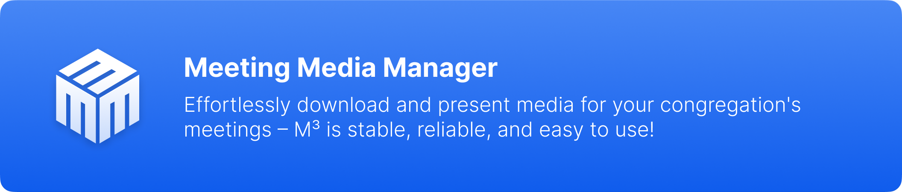
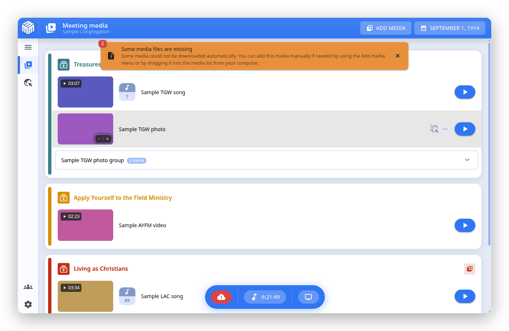

# Maipapan iti Meeting Media Manager (M³) {#about-meeting-media-manager-m3}

## Ania daytoy nga app? {#what-is-this-app}

Ti **Meeting Media Manager**, wenno **M³** no paiklien, ket kompleto nga app para iti Windows, macOS ken Linux nga automatiko nga agi-download, agurnos, ken agipakita kadagiti ladawan ken video para kadagiti gimong ti kongregasion dagiti Saksi ni Jehova. Suportaranna ti aniaman a lengguahe nga adda iti opisial a website dagiti Saksi ni Jehova, ken addaan iti nabileg a ramit iti panangimaneho iti media bayat dagiti hybrid a gimong ken gimong a personal a tabunuan.

Mabalin nga imaneho ti M³ ti kadawyan ken custom a media ti gimong, ti adu a kongregasion ken/wenno grupo nga agus-usar iti isu met laeng nga account iti kompiuter, ken addaan iti advanced a feature iti panangipakita a mangpalaka iti panangi-share iti media.

:::info Palagip

Daytoy nga app ket naam-ammo idi kas JWMMF (JW Meeting Media Fetcher), ngem nasukatan ti naganna iti Meeting Media Manager idi Mayo 2022.

:::

## Apay a piliem ti M³? {#why-choose-m3}

Ti M³ ti kasayaatan a ramit iti panangimaneho iti media ti gimong, a mangipaay iti nalam-ay, mapagtalkan, ken nabaknang iti feature a panangusar iti aniaman a platform. Naisangsangayan a naaramid para kadagiti kasapulan dagiti gimong ti kongregasion, ket ipaayna amin a kasapulan para iti epektibo a panangipakita iti media.

### Kangrunaan a pagimbagan {#key-benefits}

- **Nalaka a panangipakita iti media**: Ti kasayaatan a panangipakita iti media — luktam laeng ti M³ ket agandar aminen. Awan ti narigat a setup wenno kanayonan nga addang a masapul.

- **Suporta para iti adu a kongregasion**: Nalaka nga imanehom dagiti setting ti adu a kongregasion wenno grupo iti maysa laeng nga app.

- **Dagiti advanced a feature**: Nalaka ti mangnayon iti kanayonan a media, agi-import iti custom a linaon, ken automatiko nga agi-share kadagiti participant iti Zoom iti mapaspasamak iti Kingdom Hall.

- **Napasayaat a panagandar iti amin a platform**: Pagragsakam ti nalam-ay ken napartak a panagandar iti Windows, macOS, ken Linux, uray kadagiti daan a sistema wenno kompiuter a limitado ti kabaelanna.

- **Mapagtalkan ken natibker**: Naaramid tapno agandar no kasapulam unay. Adda nasarakam a bug? I-report-mo, ket dagus a maasikaso dayta.

- **Dagiti advanced a ramit iti panangipakita**: Advanced a kontrol ti media, zoom/pan, custom nga oras, ken nalam-ay nga integration ti Zoom ken OBS Studio.

## Ania ti maaramidan ti M³? {#what-can-m3-do}

Ti M³ ket kompleto a solusion iti panangimaneho iti media a mangtulong kenka a nalaka ken automatiko nga agi-download, agi-sync, agi-share, ken agipakita iti amin a media ti gimong. Dagitoy ti makagapu a nabileg ti M³:

### Kangrunaan a Panangimaneho iti Media {#core-media-management}

- **Automatiko a panangi-download iti media**: Automatiko nga alaenna ken i-download-na amin a media a kasapulan kadagiti dumteng a gimong
- **Suporta para iti adu a lengguahe**: I-download ti media iti aniaman kadagiti ginasut a lengguahe nga adda
- **Nasirib a panangi-cache**: Nasirib a sistema ti panangi-cache a mangtaginayon a naurnos ken na-update ti media
- **Pannakaurnos ti media**: Automatiko nga urnosenna ti media sigun iti petsa ken seksion ti gimong

### Dagiti Feature ti Panangipakita iti Media {#about-presentation-features}

Para kadagiti gimong ti kongregasion a **hybrid** wenno **personal a tabunuan**, addaan ti nairaman a mode ti panangipakita iti media iti:

- **Advanced a kontrol ti media**: Dagiti thumbnail ti media nga addaan iti zoom ken pan
- **Custom nga oras**: I-set ti custom nga oras ti panangrugi ken panaggibus ti panangi-play iti media
- **Dagiti kontrol ti panangi-play**: Nalaka nga usaren dagiti button a pang-pause, pang-play ken pangisardeng, agraman dagiti keyboard shortcut
- **Live a preview ken kontrol ti kapartak**: Kitaen ti preview ti iskrin a makita dagiti agdengdengngeg, ken no kayatmo, baliwan ti kapartak ti panangi-play iti audio wenno video
- **Suporta para iti adu nga iskrin**: Automatiko a pannakailasin ken pannakaimaneho dagiti external nga iskrin
- **Nadalus a panangipakita**: Interface ti panangipakita iti media nga awan ti makasinga iti atension

### Background Music {#about-background-music}

- **Nasirib a panangi-play**: Background music nga automatiko nga agsardeng sakbay a mangrugi dagiti gimong
- **Panangirugi manen iti maysa a click**: Ituloy ti background music iti maysa laeng a click kalpasan dagiti gimong
- **Kontrol ti kapigsa ti uni**: Mabaliwan ti kapigsa ti uni ti background music, agraman ti in-inut a panagkapsut ti uni

### Integration ti Zoom {#about-zoom-integration}

- **Automatiko a panangi-share iti iskrin**: Automatiko nga irugi ken isardeng ti panangi-share iti iskrin iti Zoom no i-play wenno isardengmo ti media

### Integration ti OBS Studio {#about-obs-integration}

- **Automatiko a panagsukat ti scene**: Nalam-ay nga integration iti OBS Studio para kadagiti hybrid a gimong
- **Panangimaneho kadagiti scene**: Automatiko a panagsukat iti nagbaetan ti scene ti kamera, scene ti media, ken dadduma pay a scene
- **Dagiti kontrol ti panangi-record**: Irugi ken isardeng dagiti recording ti OBS manipud iti M³ no naka-enable

### Panangi-import ken Panangimaneho iti Media {#about-media-import}

- **Dagiti JWPUB a file**: Nalaka nga i-import ken imaneho dagiti JWPUB a file
- **Dagiti JWLPLAYLIST a file**: Suporta para kadagiti file ti playlist ti JW Library
- **Custom a media**: I-import dagiti custom a video, ladawan, file ti audio, ken PDF a file
- **Media ti Biblia**: I-import ti media ti Study Bible, media ti Biblia iti sign language, ken dagiti audio recording ti Baro a Lubong a Patarus
- **Dagiti palawag publiko**: Kanayon a nakasagana ti pakabuklan ti media para iti palawag publiko babaen ti panangi-import iti S-34

### Dagiti Advanced a Feature {#about-advanced-features}

- **Nai-share a folder**: Automatiko nga inayon ti media kadagiti gimong manipud iti folder a kanayon nga i-sync ti Dropbox, OneDrive, iCloud Drive wenno Google Drive
- **Panangi-export iti media**: Automatiko nga i-export ti media kadagiti folder, a naurnos sigun iti petsa
- **Panangipakita iti website**: Ipakita ti opisial a website kadagiti external nga iskrin
- **Timer ti gimong**: Opsional a window ti timer tapno maorasan dagiti paset ti gimong
- **Dagiti katulongan iti panangi-record iti gimong**: Kontrolen ti panangi-record iti OBS wenno ti external nga app a pang-record
- **Dagiti keyboard shortcut**: Mabalin a baliwan dagiti keyboard shortcut para iti adu a function
- **Adu a profile**: Imaneho ti nadumaduma a kongregasion wenno grupo babaen ti naisalumina a profile, agraman ti panangi-import ken panangi-export kadagiti setting ti profile

## Agandar kadi ti M³ iti lengguahek? {#does-m3-work-in-my-language}

**Wen!** Kompleto ti suporta ti M³ para iti adu a lengguahe:

Mabalin nga automatiko a mai-download ti media para kadagiti gimong dagiti Saksi ni Jehova iti aniaman kadagiti ginasut a lengguahe nga adda iti opisial a website dagiti Saksi ni Jehova. Automatiko a mai-update ti listaan dagiti lengguahe nga adda; piliem laeng ti kasapulam bayat ti setup.

### Dagiti Lengguahe ti App {#interface-languages}

Ti M³ a mismo ket impatarus dagiti boluntario iti adu a lengguahe. Mabalinmo nga i-set ti lengguahe a kayatmo a maipakita iti interface ti M³, a saan a mainaig iti lengguahe a mausar iti panangi-download iti media. Kayat a sawen daytoy a mabalinmo nga usaren ti M³ iti kayatmo a lengguahe bayat nga agi-download-ka iti media iti aniaman a sabali a lengguahe a masuportaran.

Para kadagiti detalye maipapan kadagiti maikadua a lengguahe ken subtitle, kitaem ti [Masansan a Maisalsaludsod](faq#language-support).

## Dagiti Kasapulan ti Sistema {#system-requirements}

Para kadagiti masuportaran nga operating system ken kasapulan, kitaem dagiti sungbat iti [Masansan a Maisalsaludsod](faq#technical-questions).

**Padasem ti M³ ita nga aldaw, ket kitaem no ania ti kabaelanna! Nalaklaka itan ngem idi ti panangipakita iti media kadagiti gimong ti kongregasion.**

