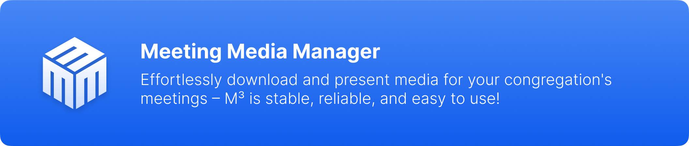
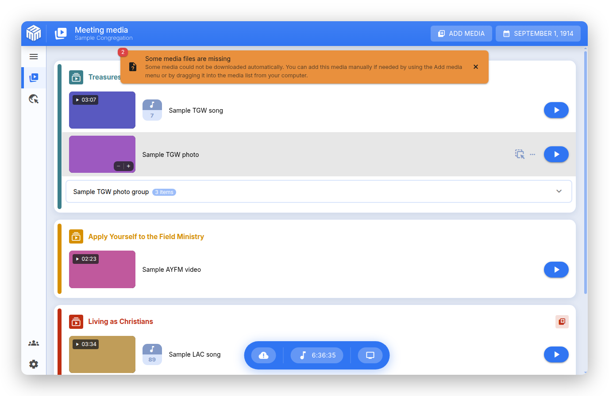

# Informazioni su Meeting Media Manager (M³) {#about-meeting-media-manager-m3}

## Cos'è questa app? {#what-is-this-app}

**Meeting Media Manager**, o **M³** in breve, è un'applicazione multipiattaforma completa per Windows, macOS e Linux che scarica, organizza e presenta automaticamente immagini e video per le adunanze di congregazione dei Testimoni di Geova. Supporta qualsiasi lingua disponibile sul sito ufficiale dei Testimoni di Geova e offre potenti strumenti per gestire i media sia durante le adunanze ibride che in presenza.

M³ supporta la gestione dei media delle adunanze regolari e di quelli personalizzati, di più congregazioni e/o gruppi che usano lo stesso account del computer, e offre funzionalità di presentazione avanzate che rendono semplicissima la condivisione dei media.

:::info Nota

Questa app era conosciuta come JWMMF (JW Meeting Media Fetcher), ma è stata rinominata Meeting Media Manager nel maggio 2022.

:::

## Perché scegliere M³? {#why-choose-m3}

M³ è lo strumento definitivo per gestire i media delle adunanze, con un'esperienza fluida, affidabile e ricca di funzionalità su tutte le piattaforme. È progettata specificamente per le esigenze delle adunanze di congregazione e fornisce tutto il necessario per una presentazione efficace dei media.

### Principali vantaggi {#key-benefits}

- **Presentazione multimediale senza sforzo**: Presentare i media al meglio — basta aprire M³ e tutto funziona. Nessuna configurazione complessa o passi extra necessari.

- **Supporto multi-congregazione**: Gestisci le impostazioni per più congregazioni o gruppi facilmente all'interno di una singola applicazione.

- **Funzioni avanzate**: Aggiungi facilmente altri media, importa contenuti personalizzati e condividi automaticamente ciò che succede alla Sala del Regno con i partecipanti su Zoom.

- **Prestazioni ottimizzate multipiattaforma**: Goditi un'esperienza fluida e reattiva su Windows, macOS e Linux, anche su vecchi sistemi o computer con risorse limitate.

- **Affidabile e stabile**: progettato per funzionare quando ne hai più bisogno. Hai trovato un bug? Segnalalo e verrà risolto rapidamente.

- **Strumenti di presentazione avanzati**: controlli multimediali avanzati, funzionalità di zoom e panoramica, tempi personalizzati e integrazione perfetta con Zoom e OBS Studio.

## Cosa può fare M³? {#what-can-m3-do}

M³ è una soluzione completa di gestione dei media che ti consente di scaricare, sincronizzare, condividere e presentare tutti i media delle adunanze in modo facile e automatico. Ecco ciò che rende M³ potente:

### Gestione principale dei media {#core-media-management}

- **Download automatico dei media**: Recupera e scarica automaticamente tutti i media necessari per le prossime adunanze
- **Supporto multilingue**: scarica i media in una qualsiasi delle centinaia di lingue disponibili
- **Smart caching**: Sistema di cache intelligente che mantiene i media organizzati e aggiornati
- **Organizzazione dei media**: organizza automaticamente i media per data e sezione dell'adunanza

### Funzionalità di presentazione dei media {#about-presentation-features}

Per le adunanze di congregazione **ibride** o **in presenza**, la modalità di presentazione integrata dei media comprende:

- **Controlli multimediali avanzati**: Miniature multimediali con capacità di zoom e panoramica
- **Tempi personalizzati**: imposta tempi di inizio e fine personalizzati per la riproduzione dei media
- **Controlli di riproduzione**: Pulsanti di pausa/riproduzione/stop facili da usare con tasti scorciatoia
- **Anteprima dal vivo e controllo della velocità**: visualizza in anteprima ciò che vede il pubblico e, se vuoi, regola la velocità di riproduzione dell'audio o del video
- **Supporto multi-monitor**: Rilevamento e gestione automatici dei monitor esterni
- **Presentazione pulita**: interfaccia di presentazione dei media senza distrazioni

### Musica di sottofondo {#about-background-music}

- **Riproduzione intelligente**: Musica di sottofondo che si ferma automaticamente prima dell'inizio delle adunanze
- **Riavvio con un clic**: Riprendi la musica di sottofondo con un solo clic dopo le adunanze
- **Controllo del volume**: volume della musica di sottofondo regolabile, con dissolvenza in chiusura

### Integrazione con Zoom {#about-zoom-integration}

- **Condivisione automatica dello schermo**: Avvia e ferma automaticamente la condivisione dello schermo di Zoom quando riproduci o interrompi i media

### Integrazione con OBS Studio {#about-obs-integration}

- **Cambio automatico della scena**: Integrazione perfetta con OBS Studio per adunanze ibride
- **Gestione delle scene**: cambio automatico tra videocamera, media e altre scene
- **Controlli di registrazione**: avvia e ferma le registrazioni di OBS da M³ quando abilitato

### Importazione e gestione dei media {#about-media-import}

- **File JWPUB**: Importa e gestisci i file JWPUB con facilità
- **File JWLPLAYLIST**: supporto per i file delle playlist di JW Library
- **Media personalizzati**: Importa video, immagini, file audio e PDF personalizzati
- **Media biblici**: importa i media della Bibbia per lo studio, i media biblici nella lingua dei segni e le registrazioni audio della Traduzione del Nuovo Mondo
- **Discorsi pubblici**: tieni sempre pronta all'uso la panoramica dei media del discorso pubblico con l'importatore S-34

### Funzionalità avanzate {#about-advanced-features}

- **Cartella condivisa**: aggiungi automaticamente i media alle adunanze da una cartella sincronizzata da Dropbox, OneDrive, iCloud Drive o Google Drive
- **Esportazione media**: Esporta automaticamente i media in cartelle, organizzati per data
- **Presentazione del sito**: Presenta il sito ufficiale sui monitor esterni
- **Timer dell'adunanza**: finestra timer facoltativa per cronometrare le parti dell'adunanza
- **Strumenti per la registrazione dell'adunanza**: controlla la registrazione di OBS o un'applicazione di registrazione esterna
- **Scorciatoie da tastiera**: Scorciatoie da tastiera personalizzabili per molte funzioni
- **Profili multipli**: gestisci congregazioni o gruppi diversi con profili separati, inclusi l'importazione e l'esportazione delle impostazioni del profilo

## M³ funziona nella mia lingua? {#does-m3-work-in-my-language}

**Sì!** M³ offre un supporto multilingue completo:

I media per le adunanze dei Testimoni di Geova possono essere scaricati automaticamente in una qualsiasi delle centinaia di lingue disponibili sul sito ufficiale dei Testimoni di Geova. L'elenco delle lingue disponibili viene aggiornato dinamicamente; devi solo selezionare quella che ti serve durante la configurazione.

### Lingue dell'interfaccia {#interface-languages}

M³ è stato tradotto in molte lingue da volontari. Puoi impostare la lingua dell'interfaccia di M³ che preferisci, indipendentemente dalla lingua usata per scaricare i media. Questo significa che puoi usare M³ nella tua lingua preferita e scaricare i media in qualsiasi altra lingua supportata.

Per dettagli sulle lingue di ripiego e i sottotitoli, consulta le [FAQ](faq#language-support).

## Requisiti di sistema {#system-requirements}

Per i sistemi operativi supportati e i requisiti, consulta le risposte nelle [FAQ](faq#technical-questions).

**Prova M³ oggi stesso e scopri tu stesso cosa può fare! Presentare i media alle adunanze di congregazione non è mai stato così facile.**

